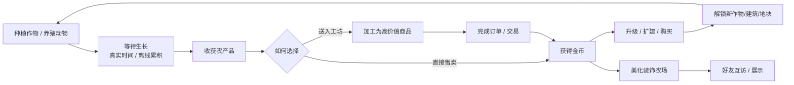
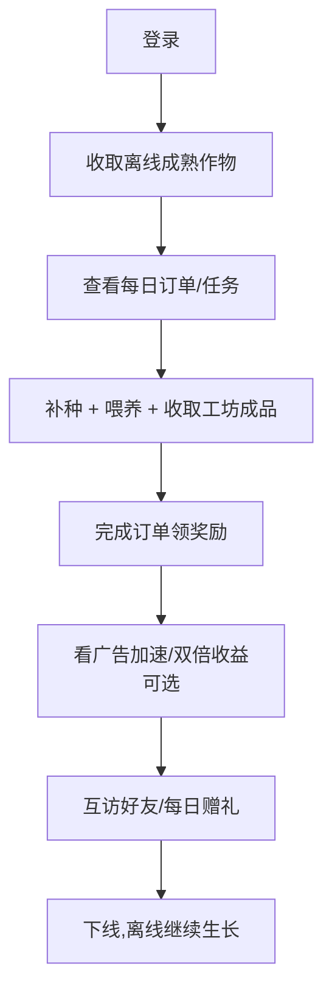
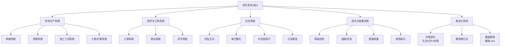
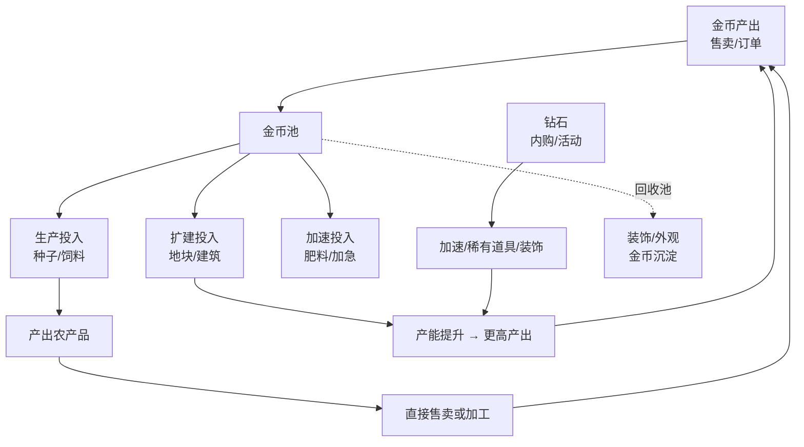
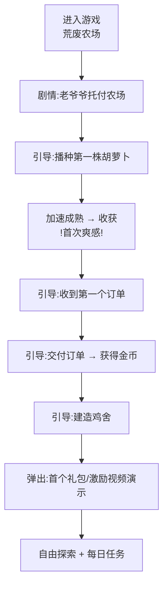
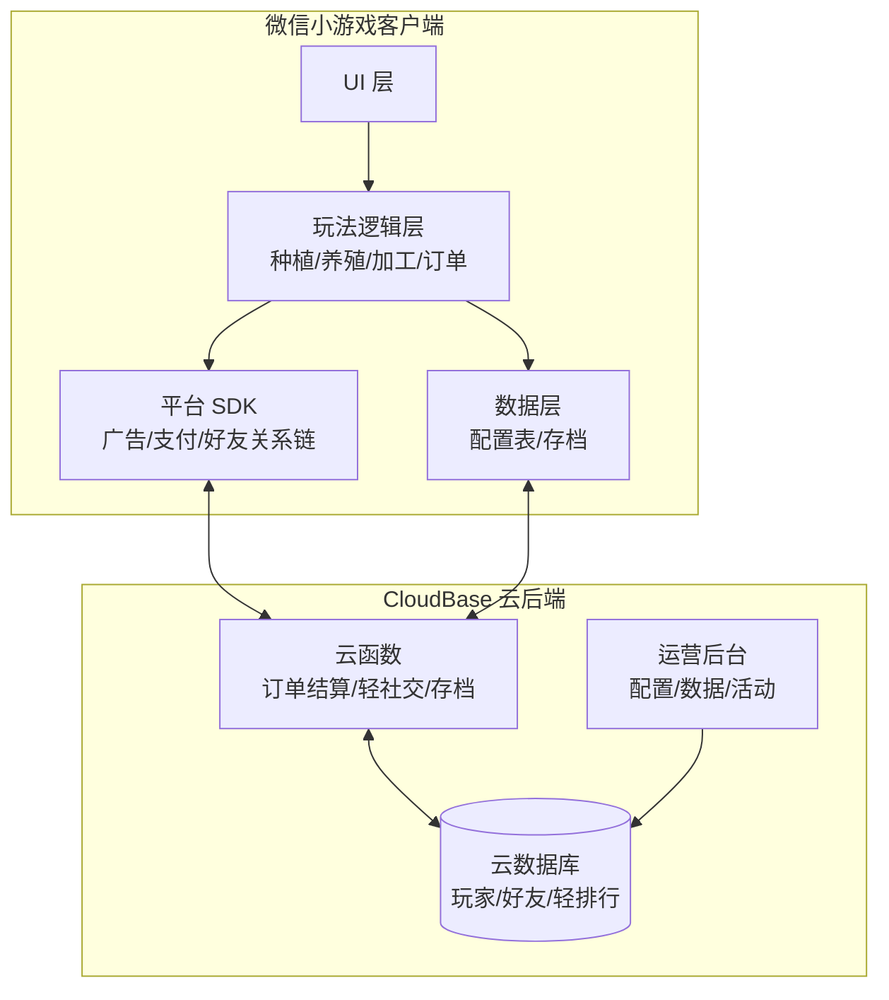
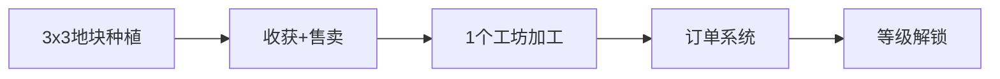

# 《欢乐农场》(Happy Farm) 游戏设计文档 GDD

> **文档类型**：商业级游戏设计文档 (Game Design Document)
> **游戏类型**：休闲模拟经营 / 农场养成 / 轻度社交
> **目标平台**：微信小游戏（移动端优先，兼容 QQ 小游戏）
> **参考标杆**：《卡通农场》Hay Day（Supercell）、《摩尔庄园》、《Small Town》系列
> **版本**：v0.2（核心决策已固化 · 评审稿）
> **日期**：2026-11-23
> **作者**：PM / 设计组

---

## 修订记录

| 版本 | 日期 | 修订人 | 说明 |
|---|---|---|---|
| v0.2 | 2026-11-23 | 设计组 | 固化 5 项核心决策：引擎对齐占地之王、轻社交、IAP 深化+部分 IAA、美术自研、小范围测试 |
| v0.1 | 2026-11-23 | 设计组 | 初版：核心玩法框架、系统拆解、数值雏形 |

---

## 目录

1. [游戏概述](#1-游戏概述)
2. [设计目标与玩家体验](#2-设计目标与玩家体验)
3. [核心玩法循环](#3-核心玩法循环)
4. [游戏系统拆解](#4-游戏系统拆解)
5. [数值设计框架](#5-数值设计框架)
6. [经济系统](#6-经济系统)
7. [新手引导流程](#7-新手引导流程)
8. [商业化设计](#8-商业化设计)
9. [UI/UX 设计](#9-uiux-设计)
10. [技术架构](#10-技术架构)
11. [数据埋点与后台统计](#11-数据埋点与后台统计)
12. [开发路线图](#12-开发路线图)
13. [风险分析](#13-风险分析)
14. [附录](#14-附录)

---

## 1. 游戏概述

### 1.1 一句话概念 (High Concept)

> 一座属于你的治愈系农场：种植、养殖、加工、接单、交易，在碎片时间里经营一片慢慢长大的田园。

### 1.2 产品定位

《欢乐农场》是一款面向泛用户、下沉市场与轻度玩家的 **微信小游戏农场经营类产品**。核心借鉴《卡通农场》(Hay Day) 久经市场验证的"种植—收获—加工—订单—扩张"循环，针对中国小游戏生态做以下适配：

- **即点即玩**：无需下载，微信/QQ 生态内直接启动，单局 3–5 分钟。
- **碎片化节奏**：作物生长用"真实时间 + 离线累积"，适配通勤、等待等碎片场景。
- **轻度社交**：好友互访、帮忙、交易，强关系链驱动留存，弱对抗无压力。
- **变现结构**：以内购（IAP）深化为主体，激励视频（IAA）作为补充与体验润滑（详见第 8 章）。

### 1.3 产品档案

| 项目 | 内容 |
|---|---|
| 游戏名称 | 欢乐农场（Happy Farm） |
| 品类标签 | 模拟经营 / 农场养成 / 放置 / 轻度社交 |
| 目标平台 | 微信小游戏（主）、QQ 小游戏（次） |
| 核心玩法 | 种植 → 养殖 → 加工 → 完成订单 → 赚金币 → 扩建升级 |
| 美术风格 | Q 版厚涂卡通 · 界面主调「晴空乐园」（天蓝/云白/明黄/活力橙），与占地之王风格一脉相承 |
| 目标用户 | 18–45 岁泛用户，女性与下沉市场占比高，轻度玩家为主 |
| 单局时长 | 3–8 分钟（碎片化多次登录） |
| 联网需求 | 弱联网（核心单机可玩，社交/云存档需联网） |
| 引擎 | **原生 JavaScript ES6 Modules + Canvas 2D + requestAnimationFrame**（与《占地之王》一致；零第三方引擎、零 npm 运行时依赖、无打包工具）|
| 美术 | **自研**（复用占地之王 Q 版厚涂卡通规范与素材管线）|
| 变现模式 | **内购（IAP）深化为主 + 部分激励视频（IAA）为辅** |
| 上线策略 | **小范围测试**（种子用户验证后再放量）|

### 1.4 竞品分析

| 维度 | 卡通农场 Hay Day | 摩尔庄园手游 | 本作《欢乐农场》 |
|---|---|---|---|
| 平台 | App Store / Google Play | 手游 | **微信小游戏（即点即玩）** |
| 上手门槛 | 中 | 中高 | **低（碎片化引导）** |
| 单局时长 | 中长 | 长 | **短（3–8 分钟）** |
| 社交强度 | 中（合作社） | 高（MMO 社区） | **中轻（微信关系链）** |
| 变现 | 内购为主 | 内购+外观 | **IAP 深化 + 部分 IAA** |
| 核心差异 | 深度经营 | 社交社区 | **轻量 + 微信裂变 + 治愈放置** |

**差异化机会点**：
1. **入口优势**：依托微信/QQ 社交关系链，好友互访与分享裂变成本极低。
2. **轻量深度**：保留 Hay Day 的经营深度感，但砍掉冗长流程，适配小游戏用户耐心。
3. **治愈放置**：强化"离线也在成长"的放置收益，降低在线焦虑。
4. **本土化运营**：节气、节日、地方特产主题活动，贴近国内用户情感。

---

## 2. 设计目标与玩家体验

### 2.1 设计 pillars（设计支柱）

| 支柱 | 含义 | 设计约束 |
|---|---|---|
| **轻松治愈** | 无失败惩罚、无强制在线、节奏舒缓 | 不做体力耗尽卡点、不做倒计时逼单 |
| **即时反馈** | 每次操作都有视觉/音效/数值回报 | 收获有动画、订单有进度条、升级有庆祝 |
| **成长可见** | 农场从荒地到繁荣的演变清晰可感 | 解锁新地块/建筑/装饰，地图逐步充实 |
| **社交温度** | 好友互助带来情感连接而非竞争压力 | 帮忙、赠礼为主，弱化排名与抢夺 |
| **碎片友好** | 随时可上、随时可走、离线有收益 | 生长按真实时间，离线累积收益 |

### 2.2 目标玩家体验 (Target Experience)

- **首次 3 分钟**：完成第一次播种到收获，获得"我能经营好"的掌控感。
- **首次 10 分钟**：完成第一笔订单，理解"种什么→卖给谁→赚多少"的经济闭环。
- **次日回访**：上线看到作物成熟、订单刷新、好友来访，产生"回来看看"的牵引。
- **长期留存**：赛季通行证、季节活动、图鉴收集、农场美化与好友互助提供长效目标。

### 2.3 玩家心理模型

```
动机层：想要一个属于自己的、会成长的小世界
   ↓
行为层：种植/收获/加工/接单/装饰/串门
   ↓
反馈层：金币叮当 + 作物跳动 + 农场变大 + 好友点赞
   ↓
情绪层：治愈感 / 成就感 / 掌控感 / 归属感
```

---

## 3. 核心玩法循环

### 3.1 核心循环图（Core Loop）



### 3.2 循环层次

| 层级 | 循环 | 时间尺度 | 驱动 |
|---|---|---|---|
| **微循环** | 播种 → 收获 → 售卖 | 30 秒 – 数分钟 | 即时反馈 |
| **中循环** | 加工链 → 订单 → 金币 → 升级 | 数十分钟 – 数小时 | 成长目标 |
| **宏循环** | 解锁区域 → 赛季通行证 → 季节活动 → 图鉴 | 数天 – 数周 | 长线留存 |

### 3.3 每日循环 (Daily Loop)



---

## 4. 游戏系统拆解

### 4.1 系统全景图



### 4.2 种植系统（核心中的核心）

**规则**：
- 农场初始拥有 3×3 = 9 块地，随等级/金币解锁更多地块（最大 12×12）。
- 每块地可播种一种作物，播种消耗种子/金币，作物按真实时间生长。
- 生长完成后进入"可收获"状态，**不会消失**（无作物枯萎惩罚，突出治愈定位）。
- 收获获得农产品 + 经验；有概率触发"暴击双倍"（约 5%，带来惊喜感）。
- 收获后地块恢复空置，可立即补种。

**操作**：点击空地 → 弹出作物选择面板 → 选择作物 → 播种 → 计时 → 点击收获。

**关键设计**：
- **离线生长**：关掉游戏后作物继续按真实时间成熟，回来一次性收取（放置核心）。
- **一键操作**：解锁后支持"一键播种/一键收获"，降低中后期操作负担。
- **肥料加速**：可用金币或广告兑换肥料缩短生长时间。

### 4.3 养殖系统

**规则**：
- 建造鸡舍、牛棚、羊圈等设施后可养殖对应动物。
- 动物"喂养"后按周期产出副产品（鸡蛋、牛奶、羊毛等）。
- 副产品可直接售卖或送入工坊加工。
- 动物有"心情值"，及时喂养/互动提升产出速度（轻度养成，不做惩罚）。

**动物示例**：

| 动物 | 设施 | 产物 | 产出周期 | 解锁等级 |
|---|---|---|---|---|
| 鸡 | 鸡舍 | 鸡蛋 | 20 分钟 | 2 |
| 牛 | 牛棚 | 牛奶 | 40 分钟 | 5 |
| 羊 | 羊圈 | 羊毛 | 60 分钟 | 8 |
| 蜜蜂 | 蜂箱 | 蜂蜜 | 30 分钟 | 12 |

### 4.4 加工工坊系统（经济纵深的关键）

**规则**：
- 工坊将初级农产品加工为高附加值商品，是订单系统的主要供给来源。
- 每个工坊有若干"加工槽位"，投入原料 → 等待加工 → 取出成品。
- 工坊数量与槽位随等级解锁，广告可加速加工。

**工坊与配方示例**：

| 工坊 | 配方 | 原料 | 产出 | 加工时间 | 成品售价 |
|---|---|---|---|---|---|
| 面包房 | 面包 | 小麦 ×3 | 面包 ×1 | 10 分钟 | 高 |
| 奶制品厂 | 奶酪 | 牛奶 ×2 | 奶酪 ×1 | 30 分钟 | 高 |
| 纺织坊 | 毛线 | 羊毛 ×2 | 毛线 ×1 | 45 分钟 | 高 |
| 榨汁机 | 果汁 | 水果 ×3 | 果汁 ×1 | 15 分钟 | 高 |

> 加工链设计原则：成品售价 > 原料直接售卖总价 × 1.5，保证加工"有利可图"，引导玩家深入加工而非只卖原料。

### 4.5 订单系统

**规则**：
- 订单是金币与经验的**主要来源**，驱动玩家有目标地生产。
- 订单分三类，刷新机制不同：

| 订单类型 | 需求 | 奖励 | 刷新 | 说明 |
|---|---|---|---|---|
| 农场订单 | 1–3 种作物/产品 | 金币 + 经验 | 每日 3–5 个 | 新手主要经济来源 |
| 卡车订单 | 多种商品组合 | 金币 + 经验 + 钻石 | 每日限定 | 中后期核心，考验备货 |
| 好友助力订单 | 邀请好友助力加速完成 | 额外金币 + 好感度 | 每日限量 | 驱动轻社交互动 |

- 订单有"交付"动作：集齐所需商品 → 点击交付 → 获得奖励 → 新订单补位。
- 不设硬性倒计时逼单（治愈定位），但可用"限时加急订单"作为激励视频场景（自愿）。

### 4.6 土地与扩建系统

- 农场地图分区块，初始解锁中心区域，外圈地块/建筑位随等级 + 金币逐步解锁。
- 解锁表现为"清理荒地/砍树/移石"，带来强烈的"开疆拓土"成就感。
- 扩建同时也是金币的主要回收池（防止通胀）。

### 4.7 社交系统（轻社交）

> **一期定位：轻社交**。只做"好友互访 + 赠礼 + 轻排行 + 分享裂变"，**不做合作社/公会**等重组织系统，控制研发与运维成本，契合治愈定位。

| 功能 | 说明 | 优先级 | 留存价值 |
|---|---|---|---|
| 好友互访 | 访问微信好友农场，可"帮忙"加速其作物/工坊，双方得小奖励 | P3 | 情感连接、互助 |
| 每日赠礼 | 免费赠送好友体力/装饰碎片，低成本激活关系链 | P3 | 关系链激活 |
| 轻排行榜 | 仅展示好友间农场等级/美化度，弱化对抗、无抢夺 | P4 | 轻度竞争 |
| 分享裂变 | 分享农场截图/求助获得奖励，依托微信生态拉新 | P2 | 拉新 |

> **设计红线**：社交以"互助、赠礼"为主，**明确不做"偷菜/抢夺"等负面交互**；不做实时同步、不做公会管理后台，保持轻量化。合作社作为远期（P4 之后）候选，视小范围测试数据再评估。

### 4.8 成长与收集系统

- **等级经验**：收获、订单、加工均产出经验；升级解锁新作物、动物、工坊、地块。
- **成就系统**：里程碑成就（首次收获、累计订单、好友数等）给予钻石/装饰奖励。
- **图鉴收集**：作物/动物/商品/装饰图鉴，激活图鉴获永久属性加成（如收获产量+1%）。
- **装饰美化**：大量可购买/活动获得的装饰物，用于个性化装扮农场，无属性付费公平（外观为主）。

---

## 5. 数值设计框架

> 以下为**初始基线数值**，用于 Demo 验证手感，正式开发需经数值调优与压力测试（见阶段五）。

### 5.1 作物数值表（示例）

| 作物 | 解锁等级 | 种子成本(金币) | 生长时间 | 收获产量 | 单品售价 | 单次毛利 | 经验 |
|---|---|---|---|---|---|---|---|
| 小麦 | 1 | 0(免费) | 1 分钟 | 2 | 3 | +6 | 1 |
| 胡萝卜 | 1 | 5 | 3 分钟 | 2 | 8 | +11 | 2 |
| 玉米 | 3 | 12 | 8 分钟 | 2 | 15 | +18 | 3 |
| 番茄 | 6 | 30 | 20 分钟 | 3 | 18 | +24 | 4 |
| 南瓜 | 10 | 60 | 45 分钟 | 3 | 35 | +45 | 6 |
| 草莓 | 15 | 100 | 90 分钟 | 3 | 60 | +80 | 9 |

**设计意图**：低级作物免费+短周期，保证新手永不"断粮"；高级作物单产利润更高但占用时间更长，形成"时间换收益"的策略取舍。

### 5.2 等级经验曲线

| 等级 | 累计经验 | 主要解锁 |
|---|---|---|
| 1 | 0 | 小麦、胡萝卜、基础地块 |
| 2 | 50 | 鸡舍 |
| 3 | 150 | 玉米、面包房 |
| 5 | 500 | 牛棚、奶制品厂 |
| 8 | 1500 | 羊圈、纺织坊 |
| 10 | 3000 | 南瓜、卡车订单 |
| 15 | 8000 | 草莓、蜂箱 |

- 升级所需经验采用分段递增：`EXP(n) = 50 × n^1.6`（n 为等级），前期平缓、后期拉长，符合轻度产品节奏。

### 5.3 数值健康校验

- **回本时间**：新增一块地/一个工坊的投资，应在 10–30 分钟内通过产出回本。
- **正收益保证**：任何生产行为毛利 > 0，杜绝"越玩越穷"。
- **离线收益上限**：设置离线累积上限（如 8 小时），防止长期挂机破坏平衡，同时通过"广告翻倍离线收益"创造变现点。

---

## 6. 经济系统

### 6.1 货币体系

| 货币 | 类型 | 获取途径 | 用途 | 通胀控制 |
|---|---|---|---|---|
| 金币 | 软通货 | 售卖、订单、成就 | 种子、建筑、扩建、加速 | 扩建/装饰作为回收池 |
| 钻石 | 硬通货 | 内购、成就、活动、订单 | 加速、稀有装饰、扩容、买道具 | 严格限量发放 |
| 好感度 | 社交货币 | 好友互访、赠礼、助力订单 | 兑换好友限定装饰/道具 | 无硬通胀，活动沉淀 |

### 6.2 经济循环图



### 6.3 通胀防控策略

1. **回收池**：持续推出高单价装饰、扩建、外观消耗金币。
2. **产出上限**：土地/工坊数量有上限，产能天花板可控。
3. **动态定价**：高阶商品随产量增加边际收益递减（软性）。
4. **监控埋点**：追踪金币产出/消耗比、人均金币存量，异常时通过活动调节。

---

## 7. 新手引导流程

### 7.1 引导设计原则

- **边玩边学**：不做纯文字弹窗轰炸，用"操作引导 + 高亮手势"嵌入真实玩法。
- **前 3 分钟出爽感**：第一次播种到收获必须在 60 秒内完成。
- **渐进解锁**：先教种植，再教订单，最后引出售卖/社交，避免信息过载。

### 7.2 新手引导时间轴



### 7.3 首日目标

| 时间 | 玩家应完成 | 情绪目标 |
|---|---|---|
| 0–1 min | 第一次播种与收获 | 惊喜、掌控感 |
| 1–3 min | 完成首个订单 | 目标感、成就 |
| 3–10 min | 建造鸡舍、接第二单 | 成长预期 |
| 10–30 min | 理解加工链、加好友 | 留存钩子建立 |

---

## 8. 商业化设计

### 8.1 变现模式总览

> **已定决策：IAP 深化 + 部分 IAA**。以 **内购为收入主体**，把付费深度做扎实（通行证、礼包、月卡、钻石礼包、外观）；**激励视频 IAA 只作为辅助补充**，承担"免费玩家体验润滑 + 广告变现试点"，不承担主要收入指标。

| 变现方式 | 场景 | 收入占比预估 | 优先级 | 用户体验影响 |
|---|---|---|---|---|
| 内购-通行证 | 赛季农场通行证（免费轨 + 高级轨 + 典藏轨） | 30% | **P0 核心** | 中（付费增值，弱付费墙） |
| 内购-钻石礼包 | 首充/成长基金/限时特惠/钻石直购 | 28% | **P0 核心** | 低 |
| 内购-月卡订阅 | 每日钻石、免广告、专属装饰、产量加成 | 15% | P1 | 低（高性价比） |
| 内购-外观/装饰 | 主题皮肤、限定装饰、农场风格套装 | 12% | P1 | 低（纯外观） |
| 激励视频 IAA | 加速、离线翻倍、双倍收获、免费抽奖 | 15% | P2 辅助 | 低（自愿获取奖励） |

### 8.2 IAP 深化设计（重点）

#### 8.2.1 赛季农场通行证（收入主轴）

- **结构**：每赛季 4–6 周，免费轨 + 高级轨（付费）+ 典藏轨（高价，含限定装饰）。
- **任务驱动**：用每日/每周任务积累通行证经验，把付费进度绑定到核心玩法（种植、订单、加工），而非额外负担。
- **奖励**：钻石、限定装饰、稀有种子、加工槽位加速卡、专属头像框。
- **定价参考**：高级轨 ¥30–45 / 赛季，典藏轨 ¥98–128（需在测试期 A/B 验证）。

#### 8.2.2 分层礼包矩阵

| 礼包 | 定位 | 触发时机 | 内容 |
|---|---|---|---|
| 首充礼包 | 破冰转化 | 首次进入商店 | 钻石 + 稀有装饰 + 加速道具，超值感 |
| 成长基金 | 长线绑定 | 等级 3–5 | 一次性购买，随等级分批返利（总回报 5–10×）|
| 每日特惠 | 高频复购 | 每日刷新 | 低价钻石+道具组合 |
| 限时主题活动包 | 节日/赛季 | 活动期 | 主题装饰 + 钻石，制造稀缺 |
| 钻石直购档位 | 通用货币 | 常驻 | ¥6/¥30/¥68/¥128/¥328 多档 |

#### 8.2.3 月卡订阅（留存 + LTV 支柱）

- **收益**：每日登录领钻石、免广告、专属产量加成（如收获 +10%）、专属装饰。
- **目的**：用低门槛持续付费绑定 30 天留存，兼顾"付费省钱"与"每日回访"双重动机。
- **注意**：产量加成需控制在温和区间（≤10%），避免破坏第 5 章数值平衡。

#### 8.2.4 外观付费（公平性护城河）

- 主题皮肤（田园/沙漠/雪原/节日）、限定装饰、农场风格套装。
- **零数值加成**，纯个性化表达——这是轻社交展示欲的变现出口，也是保护免费玩家生态的关键。

### 8.3 激励视频 IAA（辅助补充）

| 场景 | 触发 | 奖励 | 频次控制 |
|---|---|---|---|
| 作物/加工加速 | 玩家点击"加速" | 立即成熟 | 每日 3 次 |
| 离线收益翻倍 | 上线收取时 | 离线收益 ×2 | 每日 1–2 次 |
| 双倍收获 | 收获前点击 | 本次产量 ×2 | 每日 3 次 |
| 免费抽奖 | 装饰扭蛋 | 随机装饰 | 每日 3 次 |

> **体验红线**：所有广告均为"玩家主动点击换奖励"，禁止强制弹窗插屏打断核心操作；新用户前 3 分钟不出现任何广告；月卡用户免广告。IAA 定位为辅助，收入占比目标控制在 20% 以内。

### 8.4 付费公平性

- 付费主要购买"时间效率"与"外观个性化"，不产生不可逆的数值碾压。
- 产量类加成控制在温和区间（≤10%），确保免费玩家通过正常游玩可获得 90% 以上的核心体验。
- 外观/装饰付费零数值加成，保护轻玩家生态。

### 8.5 关键变现指标（参考行业基线）

| 指标 | 健康区间 | 说明 |
|---|---|---|
| 付费率 (IAP) | 5%–10% | IAP 深化目标高于纯 IAA 产品 |
| ARPPU | 依礼包定价 | 需 A/B 测试 |
| 首充转化率 | 15%–25% | 首充礼包效果关键 |
| 通行证购买率 | 8%–15% | 赛季主轴健康度 |
| 月卡续费率 | 40%–60% | 长线 LTV 支柱 |
| 广告渗透率 | 20%–40% | 辅助定位，低于纯 IAA 产品 |
| 人均日广告次数 | 2–4 次 | 克制频次，保护留存 |

---

## 9. UI/UX 设计

### 9.1 美术风格（自研）

> **已定决策：美术自研**，复用《占地之王》已验证的 Q 版厚涂卡通道路与规范，降低磨合与外包成本。

- **风格**：Q 版厚涂卡通，与占地之王一脉相承；界面主调「晴空乐园」（天蓝/云白/明黄/活力橙），自然场景以草地绿、暖阳黄为主。
- **视角**：45° 俯视斜角（isometric-like），营造立体农场感。
- **角色**：圆润可爱的小农夫、动物拟人化，表情丰富。
- **动效**：收获弹跳、金币飞入、作物生长的小幅摆动，强化"活着的农场"。
- **管线**：自研素材清单 + 图集 + `assets/` 分包，品质标杆沿用占地之王「幼龙」级别基准。

### 9.2 主界面信息架构

```
┌─────────────────────────────┐
│ [头像/等级]  金币💰  钻石💎  │  ← 顶部资源栏
├─────────────────────────────┤
│                             │
│      农场主场景（可拖拽）    │  ← 核心交互区
│   [地块][动物][工坊][装饰]   │
│                             │
├─────────────────────────────┤
│ [订单] [商店] [好友] [任务]  │  ← 底部功能栏
└─────────────────────────────┘
```

### 9.3 交互原则

- **单手操作**：核心按钮位于屏幕下半区，适配移动端单手握持。
- **一眼可读**：关键状态（可收获、订单完成）用明显角标/光效提示。
- **少层级**：常用功能 ≤ 2 次点击可达。
- **反馈即时**：任何点击都有音效 + 视觉回馈，避免"点了没反应"。

---

## 10. 技术架构

### 10.1 技术选型

> **已定决策：引擎与《占地之王》(KingOfTheOccupiers) 完全一致**，复用团队已跑通的自研技术栈与发布经验，零第三方引擎依赖。

| 层面 | 选型 | 理由 |
|---|---|---|
| 引擎 | **无第三方引擎**：原生 JavaScript ES6 模块（import/export，无打包工具） | 与占地之王一致，零 npm 运行时依赖，团队完全掌握 |
| 渲染 | **Canvas 2D + requestAnimationFrame** | 沿用占地之王渲染体系，2D 卡通表现力足够 |
| 平台 | 微信小游戏（主）+ QQ 小游戏（次） | 复用现有小游戏适配层、安全区/分享/返回键处理 |
| 工程结构 | 入口桩 `game.js` + `src/` 分层（config/data/entity/game/system/world/net/utils/meta） | 直接复刻占地之王目录规范 |
| 资源分包 | `assets/` 整目录配置为微信分包 + 主包 loading 进度页 | 美术自研资源量大，沿用占地之王 37MB 分包方案 |
| 后端 | 腾讯云 CloudBase（云函数 + 云数据库） | 团队已接入，支撑轻社交/云存档/运营后台 |
| 存档 | `wx.setStorageSync`（本地） + 云端同步 | 弱网可续玩，核心进度云同步 |
| 广告 | 微信广告组件（激励视频，辅助 IAA） | 平台原生，变现合规 |
| 支付 | 微信小游戏虚拟支付 | IAP 深化的合规通道 |

### 10.2 系统架构图



### 10.3 关键技术要求

- **配置驱动**：作物/动物/配方/订单等数值全部配置表化（Excel → JSON），支持热更新，便于数值调优与运营配置。
- **离线时间戳**：以服务器时间为准计算生长/离线收益，防本地时间作弊。
- **弱网处理**：关键操作本地先行 + 云端补单，保证体验流畅。
- **分包加载**：美术资源分包，首包控制在微信小游戏限制内（主包 ≤ 4MB，总包合规）。

---

## 11. 数据埋点与后台统计

> 对应项目阶段六：运营后台统计数据接入。以下为核心埋点需求，供后台设计参考。

### 11.1 核心埋点事件

| 事件名 | 触发时机 | 关键参数 | 用途 |
|---|---|---|---|
| `game_start` | 启动游戏 | 渠道、设备、新老用户 | 拉新/留存分析 |
| `tutorial_step` | 引导步骤 | step_id、耗时 | 引导漏斗优化 |
| `crop_plant` | 播种 | crop_id、地块 | 玩法活跃度 |
| `crop_harvest` | 收获 | crop_id、产量 | 产出监控 |
| `order_complete` | 完成订单 | order_type、奖励 | 经济健康度 |
| `ad_watch` | 观看广告 | scene、时长、eCPM | 变现分析 |
| `iap_purchase` | 内购 | 商品、金额 | 收入分析 |
| `friend_visit` | 好友互访 | 好友数 | 社交活跃度 |
| `level_up` | 升级 | 等级、耗时 | 成长节奏 |
| `retention` | 回访 | D1/D3/D7 | 留存分析 |

### 11.2 运营后台核心看板

- **规模指标**：DAU / MAU / 新增 / 新老占比
- **留存**：次日/3日/7日/30日留存率
- **变现**：广告收入、eCPM、ARPU、付费率
- **经济健康**：金币产出/消耗比、人均存量、通胀预警
- **玩法漏斗**：引导完成率、各系统渗透率、订单完成率
- **社交**：好友数分布、互访/赠礼活跃度、分享裂变系数 (K因子)

### 11.3 数据驱动调优

- 通过漏斗定位流失节点 → 优化引导/数值。
- 通过经济看板动态调整产出与回收 → 稳定经济。
- 通过广告场景数据调整频次与奖励 → 平衡变现与留存。

---

## 12. 开发路线图

> 对齐团队既定的六阶段开发流程。

| 阶段 | 名称 | 核心交付 | 本阶段与本 GDD 的关系 |
|---|---|---|---|
| 阶段一 | 游戏设计 | 本 GDD、数值表、美术风格定义 | ✅ 当前阶段 |
| 阶段二 | Demo 流程与测试 | 可玩 Demo：种植→收获→订单→升级最小闭环 | 验证核心循环手感 |
| 阶段三 | 完整流程与测试 | 全系统：养殖/工坊/轻社交/装饰/活动 | 落地第 4 章全部系统（社交按轻社交实现）|
| 阶段四 | 微信对接 | 登录/云开发/IAP 支付/激励视频/分享接入 | 落地第 8、10 章 |
| 阶段五 | 内容测试 | 数值调优、平衡性测试、QA、**小范围种子用户测试** | 验证第 5、6 章数值与 IAP 定价 |
| 阶段六 | 后台统计数据接入 | 埋点上报、运营后台、数据看板 | 落地第 11 章 |

### 12.1 MVP 优先范围（阶段二 Demo）



**MVP 必须验证的假设**：
1. 种植→收获的"爽感"是否成立？
2. 订单驱动的生产目标是否清晰？
3. 离线收益是否能有效驱动次日回访？

### 12.2 建议迭代优先级（RICE 思路）

| 优先级 | 系统 | 理由 |
|---|---|---|
| P0 | 种植/收获/订单/升级 | 核心循环，Demo 必做 |
| P1 | 养殖/工坊/离线收益 | 经济纵深与留存 |
| P2 | 广告变现/新手引导 | 商业化与留存关键 |
| P3 | 轻社交（好友互访/赠礼/轻排行） | 长线留存 |
| P4 | 装饰/图鉴/活动 | 收集与长效运营 |

---

## 13. 风险分析

| 等级 | 风险 | 描述 | 缓解措施 |
|---|---|---|---|
| 🔴 高 | 同质化竞争 | 农作品类竞品众多，Hay Day 已占心智 | 强化微信社交裂变 + 治愈放置 + 本土化运营的差异化 |
| 🔴 高 | IAP 深化与留存冲突 | 付费墙过重、礼包过密会伤害轻度用户体验与小范围测试口碑 | 以通行证/月卡/外观为主，数值加成温和（≤10%）；用小范围测试验证付费率与留存平衡 |
| 🟠 中 | 经济通胀 | 长线运营金币溢出、失去追求 | 持续回收池 + 动态定价 + 数据监控预警 |
| 🟠 中 | 内容消耗快 | 轻度用户很快玩完现有内容 | 配置驱动快速上新 + 季节活动 + 图鉴长线目标 |
| 🟠 中 | 首包体积 | 美术资源多导致首包超限 | 分包加载、资源压缩、图集优化 |
| 🟡 低 | 合规风险 | 小游戏内购/广告政策变动 | 严格遵循微信小游戏平台规范，预留合规调整空间 |
| 🟡 低 | 时间作弊 | 本地时间改表刷生长 | 以服务器时间为准校验 |

---

## 14. 附录

### 14.1 核心决策记录（2026-11-23 已确认）

> 以下 5 项由项目负责人拍板，本 GDD v0.2 已按此固化。

| # | 决策项 | 最终结论 | 落地章节 |
|---|---|---|---|
| 1 | 引擎选型 | **与《占地之王》一致**：原生 JS ES6 模块 + Canvas 2D + RAF，无第三方引擎、零运行时依赖 | 10.1 / 10.2 |
| 2 | 社交深度 | **轻社交**：好友互访/赠礼/轻排行/分享裂变，不做合作社 | 4.7 |
| 3 | 变现侧重 | **IAP 深化 + 部分 IAA**：内购为主体（通行证/礼包/月卡/外观），激励视频为辅助 | 第 8 章 |
| 4 | 美术资源 | **自研**：复用占地之王 Q 版厚涂卡通规范与素材管线 | 9.1 |
| 5 | 上线节奏 | **小范围测试**：种子用户验证后再决定是否放量 | 12.1 |

**遗留待细化**（进入 Demo 阶段前补充）：具体数值调优、美术素材清单拆分、内购定价 A/B 方案、种子用户规模与渠道。

### 14.2 设计原则备忘（团队共识）

- ✅ 无失败惩罚、无强制在线、无强制广告。
- ✅ 一切数值配置化，支持热更新和运营调优。
- ✅ 所有函数/变量/事件遵循团队规范，带中文注释与描述。
- ✅ 重大改动前做备份快照。
- ✅ 修复类工作在验证工程隔离进行，出报告审核后回灌。

### 14.3 参考与延伸阅读

- Supercell《Hay Day》系统设计分析
- 微信小游戏开发者文档（广告、虚拟支付、开放数据域）
- 腾讯云 CloudBase 小游戏解决方案文档
- 休闲游戏 IAA + IAP 混合变现行业报告

---

> **文档状态**：v0.2 决策固化稿。5 项核心决策已按负责人拍板更新（引擎/社交/变现/美术/上线节奏）。所有数值为初始基线，需经 Demo 验证与数值调优后定稿。
